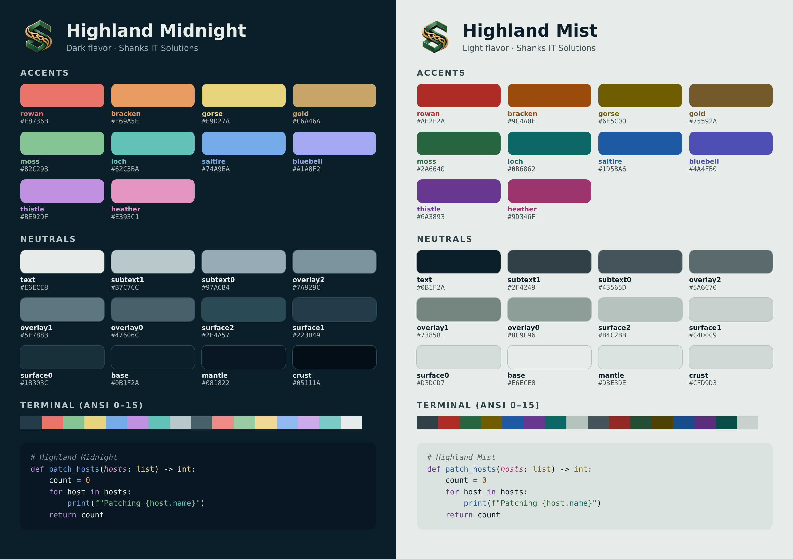
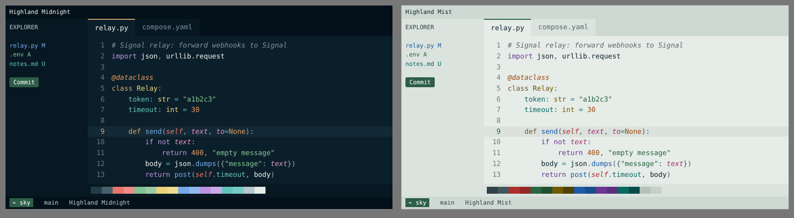

<p align="center"></p>

<h1 align="center">Highland</h1>

<p align="center">
  <a href="https://github.com/YOUR-GITHUB-USER/highland/actions/workflows/build.yml"></a>
  <a href="https://github.com/YOUR-GITHUB-USER/highland/releases/latest"></a>
  <a href="LICENSE"></a>
</p>

A Scottish Highland color palette from the **Shanks IT Solutions** brand.
It works the same way as Catppuccin, Dracula or Tokyo Night: one palette, named colors,
and ready-made themes ("ports") for many apps.





## Flavors

| Flavor | Type | Base |
|---|---|---|
| **Highland Midnight** | Dark | `#0B1F2A` (brand Highland Midnight) |
| **Highland Mist** | Light | `#E6ECE8` (brand Highland Mist) |

All accent and text colors pass WCAG AA (4.5:1 or more) against `base` in both flavors.

## Palette

Accents use Scottish names. Neutrals use the same role names as Catppuccin,
so you can port any Catppuccin theme by swapping the hex values.

| Name | Meaning | Midnight | Mist |
|---|---|---|---|
| `rowan` | Rowan berry red | `#E8736B` | `#AE2F2A` |
| `bracken` | Autumn bracken orange | `#E69A5E` | `#9C4A0E` |
| `gorse` | Gorse flower yellow | `#E9D27A` | `#6E5C00` |
| `gold` | Celtic gold | `#C6A46A` | `#75592A` |
| `moss` | Moss green | `#82C293` | `#2A6640` |
| `loch` | Loch teal | `#62C3BA` | `#0B6862` |
| `saltire` | Saltire blue | `#74A9EA` | `#1D5BA6` |
| `bluebell` | Scottish bluebell | `#A1A8F2` | `#4A4FB0` |
| `thistle` | Thistle purple | `#BE92DF` | `#6A3893` |
| `heather` | Heather pink | `#E393C1` | `#9D346F` |
| `text` |  | `#E6ECE8` | `#0B1F2A` |
| `subtext1` |  | `#B7C7CC` | `#2F4249` |
| `subtext0` |  | `#97ACB4` | `#43565D` |
| `overlay2` |  | `#7A929C` | `#5A6C70` |
| `overlay1` |  | `#5F7883` | `#738581` |
| `overlay0` |  | `#47606C` | `#8C9C96` |
| `surface2` |  | `#2E4A57` | `#B4C2BB` |
| `surface1` |  | `#223D49` | `#C4D0C9` |
| `surface0` |  | `#18303C` | `#D3DCD7` |
| `base` |  | `#0B1F2A` | `#E6ECE8` |
| `mantle` |  | `#081822` | `#DBE3DE` |
| `crust` |  | `#05111A` | `#CFD9D3` |

Brand colors (fixed, not part of the flavors): Forest `#2D5E47`, Gold `#C6A46A`,
Midnight `#0B1F2A`, Mist `#E6ECE8`, Thistle `#5B2E7E`.
Selections and primary buttons use **Forest** as the background.

## Syntax mapping (same in every editor port)

| Code element | Color |
|---|---|
| Comments | `overlay2`, italic |
| Keywords | `thistle` |
| Functions | `saltire` |
| Strings | `moss` |
| Numbers, constants | `bracken` |
| Types, classes | `gorse` |
| Storage / modifiers | `gold` |
| Properties, operators | `loch` |
| Parameters | `heather`, italic |
| Tags | `rowan` |

## Download

Get the latest ZIP and the VS Code `.vsix` from [**Releases**](https://github.com/YOUR-GITHUB-USER/highland/releases/latest),
or clone the repo. Step-by-step instructions for every app: [**INSTALL.md**](INSTALL.md).

## Ports and install

| App | Files | Install |
|---|---|---|
| **KDE Plasma** | `ports/kde/*.colors` | Copy to `~/.local/share/color-schemes/`, then System Settings → Colors & Themes → Colors |
| **Konsole** | `ports/konsole/*.colorscheme` | Copy to `~/.local/share/konsole/`, then Settings → Edit Current Profile → Appearance |
| **VS Code** | `.vsix` from Releases (or `make vsix`) | `code --install-extension highland-theme-1.0.0.vsix`, then Ctrl+K Ctrl+T → Highland |
| **Kitty** | `ports/kitty/*.conf` | Copy to `~/.config/kitty/`, add `include highland-midnight.conf` to `kitty.conf` |
| **Alacritty** | `ports/alacritty/*.toml` | Copy to `~/.config/alacritty/`, add `[general] import = ["~/.config/alacritty/highland-midnight.toml"]` |
| **WezTerm** | `ports/wezterm/*.toml` | Copy to `~/.config/wezterm/colors/`, set `config.color_scheme = "Highland Midnight"` |
| **Windows Terminal** | `ports/windows-terminal/*.json` | Settings → Open JSON file → paste the object into `"schemes": [ ]`, then pick it in the profile |
| **Vim / Neovim** | `ports/vim/colors/*.vim` | Copy `colors/` to `~/.vim/colors/` or `~/.config/nvim/colors/`. Use `set termguicolors` and `colorscheme highland` (follows `background`), or `highland-midnight` / `highland-mist` |
| **btop** | `ports/btop/*.theme` | Copy to `~/.config/btop/themes/`, then Options (`o`) → color theme |
| **bat** | `ports/bat/*.tmTheme` | Copy to `$(bat --config-dir)/themes/`, run `bat cache --build`, use `--theme="Highland-Midnight"` |
| **fzf** | `ports/fzf/*.sh` | Add `source /path/to/highland-midnight.sh` to `~/.bashrc` or `~/.zshrc` |
| **Starship** | `ports/starship/highland.toml` | Paste the palettes into `~/.config/starship.toml` and set `palette = "highland_midnight"` |

Palette files for design and web: `palette/` has `palette.json`, `highland.css`,
`_highland.scss`, `tailwind.highland.js`, and GIMP/Inkscape/Krita palettes (`.gpl`).

## Quick install on KDE Plasma

```bash
git clone https://github.com/YOUR-GITHUB-USER/highland.git && cd highland
make install-kde
plasma-apply-colorscheme HighlandMidnight
```

## Repository layout

```
palette.json      the colors (single source of truth)
scripts/          generators + highland_lib.py + check.py
ports/            generated app themes (do not edit by hand)
palette/          generated CSS / SCSS / Tailwind / .gpl / JSON
previews/         screenshots
assets/           logo and extension icon
```

## Build

```bash
make build     # regenerate all ports from palette.json
make check     # validate files + WCAG contrast
make vsix      # package the VS Code extension (Node.js)
make dist      # release files in dist/
```

See [CONTRIBUTING.md](CONTRIBUTING.md) to add a port or change a color.

## License

MIT, Shanks IT Solutions, 2026.
